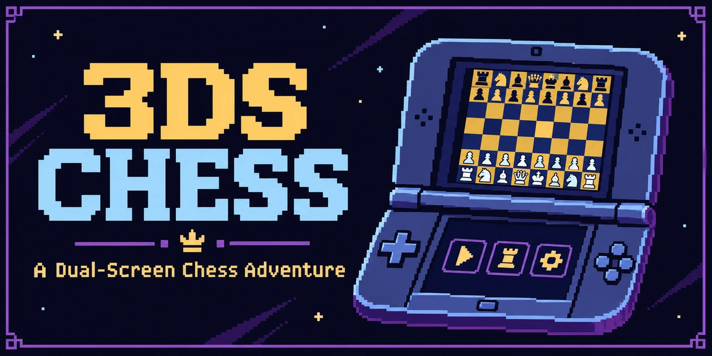
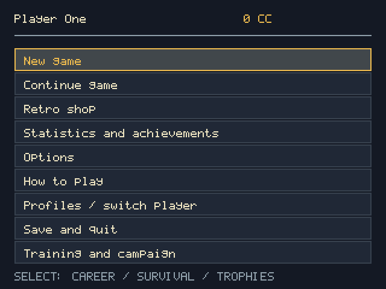
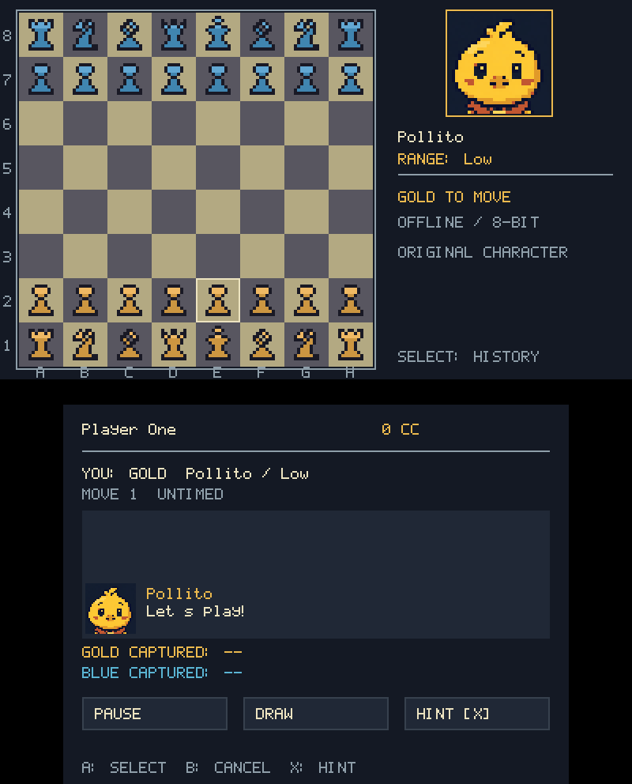

# 3DS Chess

**A dual-screen chess adventure for Nintendo 3DS.** Play offline against a cast of pixel-art rivals, share the console for local two-player games, or train at your own pace. The project targets the Old Nintendo 3DS XL and uses its own C++17 chess engine.

**English** · [Español](docs/README_ES.md) · [Gallery](#gallery) · [Build](docs/BUILDING.md) · [Roadmap](docs/ROADMAP.md) · [Contribute](CONTRIBUTING.md) · [GitHub settings](docs/GITHUB.md)

  

## Gallery

These images come from the game's desktop test renderer on **1.4.0 RC2**. The profiles are synthetic. The gallery labels its source so you can tell which screens belong to the newer candidate.

| Main menu | Match |
| --- | --- |
|  |  |

[View rivals, profiles, trophies, diagnostics and training →](docs/media/README.md)

## What you can play on `main`

| Area | Included in 1.1.0 RC Legacy |
| --- | --- |
| Gameplay | Offline AI, local two-player and practice with undo. Optional clocks, hints, game review and rematches. |
| Chess engine | Native legal move generation and six difficulty levels. Classical chess plus Chess960, Three-check and King of the Hill. |
| Training | Academy, puzzles, opening explorer, position editor and custom challenges. |
| Rivals | 40 opponents with portraits, expressions and fictional lines. |
| Progression | Three independent profiles, Career, Survival, tournaments and a 19-trophy room. |
| Customization | Board and piece options, cosmetic shop, optional music and reduced motion. |
| Localization | Spanish interface and selectable move notation. Full Spanish/English UI arrives on the 1.2 branch. |
| Diagnostics | The startup checks and log viewer arrive on the diagnostic and stability branches. |

**Controls** · The D-pad moves the cursor, **A** confirms, **B** returns, **START** pauses and **X** requests a hint. Menus on the lower screen accept touch. [Complete controls guide](docs/CONTROLS_GUIDE.md)

## Branches and verification

| Branch | Game version | Status |
| --- | --- | --- |
| `main` | **1.1.0 RC Legacy** | Default branch. [Legacy test report](docs/LEGACY_COMPLETE.md) distinguishes host, ARM and emulator checks. |
| [Space & Language](https://github.com/Perrodevs/3ds-chess/tree/feature/space-language-update) | **1.2.0 RC2** | Bilingual UI and Space update. |
| [50 Rivals](https://github.com/Perrodevs/3ds-chess/tree/feature/50-rivals) | **1.3.0 RC1** | Expanded rival roster. |
| [Diagnostic System](https://github.com/Perrodevs/3ds-chess/tree/feature/diagnostic-system) | **1.4.0 RC1** | Startup checks and diagnostic logs. |
| [Stability & Quality](https://github.com/Perrodevs/3ds-chess/tree/fix/stability-quality-update) | **1.4.0 RC2** | Latest tested candidate. Host and ARM checks passed. Azahar verified selected flows. Physical validation is pending. [Report](https://github.com/Perrodevs/3ds-chess/blob/fix/stability-quality-update/docs/STABILITY_140_RC2.md). |

The [roadmap](docs/ROADMAP.md) tracks the remaining hardware and asset checks. The [changelog](CHANGELOG.md) records this branch's history.

[Host checks on GitHub](https://github.com/Perrodevs/3ds-chess/actions/workflows/checks.yml)

## How it works

C++17, devkitARM and libctru run the game natively. Citro2D/Citro3D render the two screens, and NDSP plays optional audio when available. The custom engine runs offline and uses bounded search. Profiles and resumable games live on the SD card. [Architecture](docs/ARCHITECTURE.md)

A clean checkout supports the [host engine checks](docs/TESTING.md#current-checkout). A full game build needs devkitPro's 3DS toolchain and an authorized portrait atlas supplied separately. [Build prerequisites and commands](docs/BUILDING.md)

### Local installation

With Homebrew Launcher already available, place an authorized `3ds-chess.3dsx` and `3ds-chess.smdh` in `SD:/3ds/3ds-chess/` and launch **3DS Chess**. Back up the folder before replacing the executable. [Troubleshooting](docs/TROUBLESHOOTING.md)

## Contributing, rights and credits

Start with [Contributing](CONTRIBUTING.md), [Code of conduct](CODE_OF_CONDUCT.md) and [Security](SECURITY.md). Pollitopio develops the game. The [credits and notices](docs/THIRD_PARTY.md) cover the toolchain and outside resources.

The original code is [MIT licensed](LICENSE). Portraits, character identities, trademarks and other third-party work have separate rights. The mixed atlas and complete builds still require distribution review. This is an independent homebrew project. [Asset inventory](docs/ASSET_RIGHTS.md)
