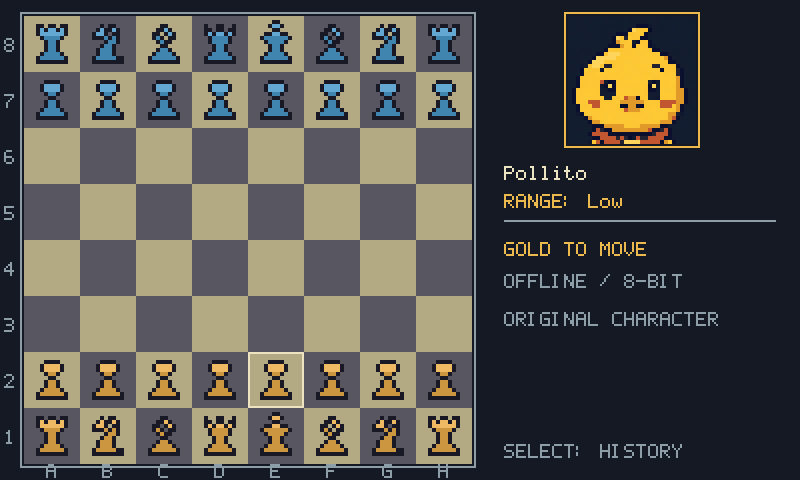
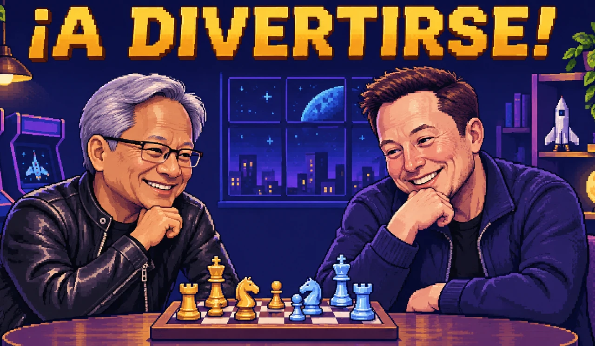

# 3DS Chess

**A dual-screen chess adventure for Nintendo 3DS.** Play offline against a cast of pixel-art rivals, share the console for local two-player games, or train at your own pace. The project targets the Old Nintendo 3DS XL and uses its own C++17 chess engine.

**English** · [Español](docs/README_ES.md) · [Gallery](#gallery) · [Build](docs/BUILDING.md) · [Roadmap](docs/ROADMAP.md) · [Contribute](CONTRIBUTING.md) · [GitHub settings](docs/GITHUB.md)

  

**Featured build · 1.4.0 RC2.** The overview describes the latest candidate, which still needs physical validation. The source on the default branch is 1.1.0 RC Legacy. [Open the RC2 branch](https://github.com/Perrodevs/3ds-chess/tree/fix/stability-quality-update).

## Gallery

The board below is a close-up from the **1.4.0 RC2** desktop test renderer. Open the full dual-screen capture to inspect the controls and rival dialogue.

[Open the full match capture](docs/media/match.webp) · [Browse all eight full-size captures](docs/media/README.md)

## What's in 1.4.0 RC2

| Area | Latest candidate |
| --- | --- |
| Gameplay | Offline AI, local two-player and practice with undo. Optional clocks, hints, review and rematches. |
| Chess engine | Native move generation and six difficulty levels. Classical chess, Chess960, Three-check and King of the Hill. |
| Training | Academy, puzzles, opening explorer, position editor and custom challenges. |
| Rivals | 50 opponents with portraits, expressions and fictional lines. Match reactions appear on the lower screen. |
| Progression | Three independent profiles, Career, Survival, tournaments and a local leaderboard for 20 trophies. |
| Customization | Board and piece options, a cosmetic shop, optional music and reduced motion. |
| Localization | Spanish and English interface, with independently selectable move notation. |
| Diagnostics | Startup SD and profile checks, a diagnostic view and rotating local logs. |

**Controls** · Use the D-pad to move, **A** to confirm, **B** to go back, **START** to pause and **X** for a hint. The lower menus also support touch. [Controls guide](docs/CONTROLS_GUIDE.md)

## Branches and verification

| Branch | Game version | Status |
| --- | --- | --- |
| `main` | **1.1.0 RC Legacy** | Default branch. [Legacy test report](docs/LEGACY_COMPLETE.md) distinguishes host, ARM and emulator checks. |
| [Space & Language](https://github.com/Perrodevs/3ds-chess/tree/feature/space-language-update) | **1.2.0 RC2** | Bilingual UI and Space update. |
| [50 Rivals](https://github.com/Perrodevs/3ds-chess/tree/feature/50-rivals) | **1.3.0 RC1** | Expanded rival roster. |
| [Diagnostic System](https://github.com/Perrodevs/3ds-chess/tree/feature/diagnostic-system) | **1.4.0 RC1** | Startup checks and diagnostic logs. |
| [Stability & Quality](https://github.com/Perrodevs/3ds-chess/tree/fix/stability-quality-update) | **1.4.0 RC2** | Latest tested candidate. Host and ARM checks passed. Azahar verified selected flows. Physical validation is pending. [Report](https://github.com/Perrodevs/3ds-chess/blob/fix/stability-quality-update/docs/STABILITY_140_RC2.md). |

The [roadmap](docs/ROADMAP.md) tracks the remaining hardware and asset checks. The [changelog](CHANGELOG.md) records this branch's history.

[Host checks on GitHub](https://github.com/Perrodevs/3ds-chess/actions/workflows/checks.yml)

## How it works

C++17, devkitARM and libctru run the game natively. Citro2D/Citro3D render the two screens, and NDSP plays optional audio when available. The custom engine runs offline and uses bounded search. Profiles and resumable games live on the SD card. [Architecture](docs/ARCHITECTURE.md)

A clean checkout supports the [host engine checks](docs/TESTING.md#current-checkout). A full game build needs devkitPro's 3DS toolchain and an authorized portrait atlas supplied separately. [Build prerequisites and commands](docs/BUILDING.md)

### Play on a Nintendo 3DS

For the console setup documented here, you need:

- **Luma3DS** is the custom firmware that enables running homebrew.
- **boot9strap** loads Luma3DS when you turn on the console.
- **Homebrew Launcher** is the menu that opens `.3dsx` apps and games such as 3DS Chess.

Set up the console using the [3DS Hacks Guide](https://3ds.hacks.guide/finalizing-setup). Back up `SD:/3ds/3ds-chess/`, then copy the authorized `3ds-chess.3dsx` and `3ds-chess.smdh` there. Open **Homebrew Launcher** and choose **3DS Chess**. [Troubleshooting](docs/TROUBLESHOOTING.md)

**You're ready. Have fun!**

## Contributing, rights and credits

Start with [Contributing](CONTRIBUTING.md), [Code of conduct](CODE_OF_CONDUCT.md) and [Security](SECURITY.md). Pollitopio develops the game. The [credits and notices](docs/THIRD_PARTY.md) cover the toolchain and outside resources.

The original code is [MIT licensed](LICENSE). Portraits, character identities, trademarks and other third-party work have separate rights. The mixed atlas and complete builds still require distribution review. This is an independent homebrew project. [Asset inventory](docs/ASSET_RIGHTS.md)
