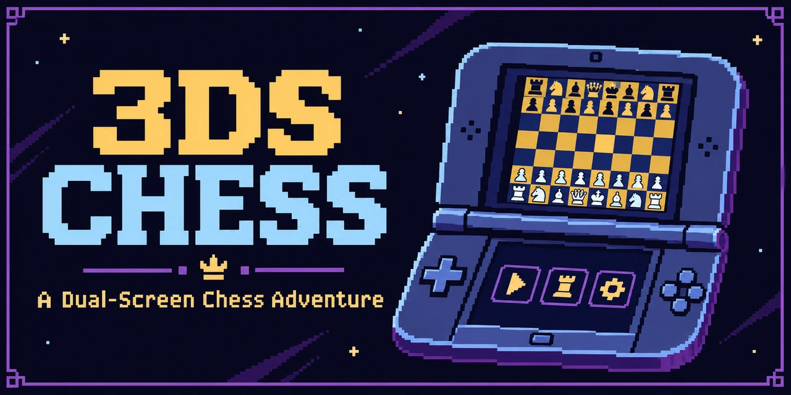
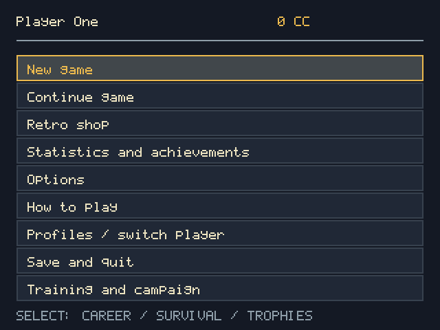
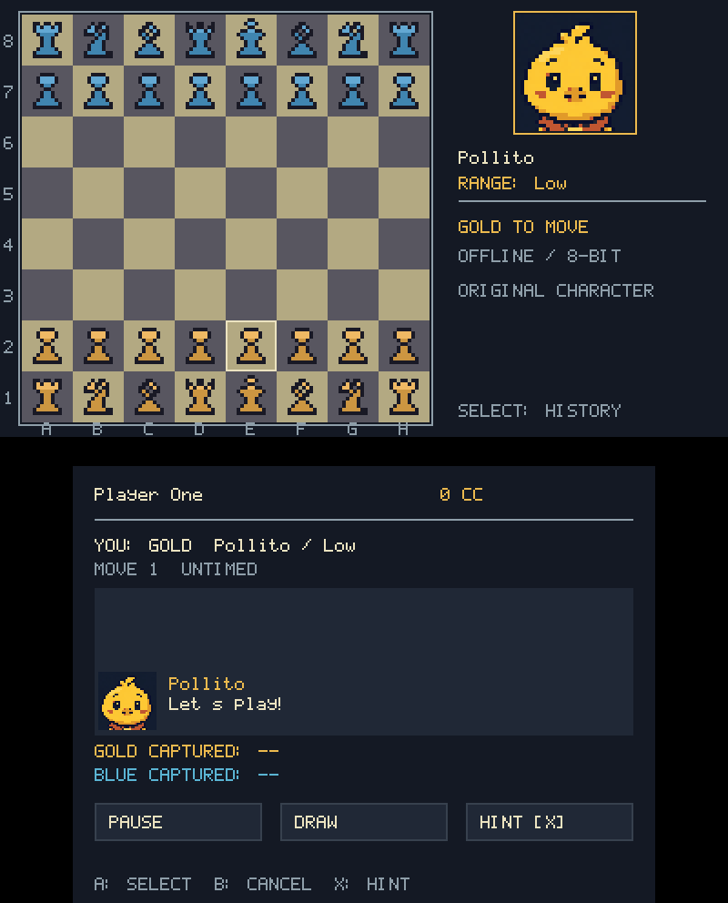

# 3DS Chess

**Una aventura de ajedrez en dos pantallas para Nintendo 3DS.** Juega sin conexión contra rivales pixel art, comparte la consola en el modo para dos o entrena a tu ritmo. El proyecto tiene como objetivo la Old Nintendo 3DS XL y usa un motor propio escrito en C++17.

[English](../README.md) · **Español** · [Galería](#galería) · [Compilación](BUILDING.md) · [Hoja de ruta](ROADMAP.md) · [Colaborar](../CONTRIBUTING.md) · [Configuración de GitHub](GITHUB.md)

  

## Galería

Estas imágenes provienen del renderizador de pruebas de escritorio del juego en **1.4.0 RC2**. Los perfiles son de prueba. La galería señala su procedencia para identificar las pantallas de la candidata más reciente.

| Menú principal | Partida |
| --- | --- |
|  |  |

[Ver rivales, perfiles, trofeos, diagnósticos y entrenamiento →](media/README.md)

## Qué puedes jugar en `main`

| Área | Incluido en 1.1.0 RC Legacy |
| --- | --- |
| Partidas | IA sin conexión, dos jugadores locales y práctica con deshacer. Relojes opcionales, pistas, revisión y revancha. |
| Motor | Generación nativa de jugadas legales y seis dificultades. Ajedrez clásico, Chess960, Three-check y King of the Hill. |
| Entrenamiento | Academia, acertijos, explorador de aperturas, editor de posiciones y retos personalizados. |
| Rivales | 40 oponentes con retratos, expresiones y frases ficticias. |
| Progresión | Tres perfiles independientes, Carrera, Supervivencia, torneos y una sala con 19 trofeos. |
| Personalización | Tableros, piezas, tienda cosmética, música opcional y movimiento reducido. |
| Idiomas | Interfaz en español y notación configurable. La interfaz bilingüe llega en la rama 1.2. |
| Diagnósticos | Las pruebas de arranque y el visor de registros llegan en las ramas de diagnóstico y estabilidad. |

**Controles** · La cruceta mueve el cursor, **A** confirma, **B** vuelve, **START** pausa y **X** solicita una pista. Los menús de la pantalla inferior aceptan toques. [Guía de controles](CONTROLS_GUIDE.md)

## Ramas y verificación

| Rama | Versión | Estado |
| --- | --- | --- |
| `main` | **1.1.0 RC Legacy** | Rama predeterminada. El [informe Legacy](LEGACY_COMPLETE.md) distingue pruebas en computadora, ARM y emulador. |
| [Space & Language](https://github.com/Perrodevs/3ds-chess/tree/feature/space-language-update) | **1.2.0 RC2** | Interfaz bilingüe y actualización Space. |
| [50 Rivals](https://github.com/Perrodevs/3ds-chess/tree/feature/50-rivals) | **1.3.0 RC1** | Catálogo ampliado de rivales. |
| [Diagnostic System](https://github.com/Perrodevs/3ds-chess/tree/feature/diagnostic-system) | **1.4.0 RC1** | Comprobaciones de arranque y registros de diagnóstico. |
| [Stability & Quality](https://github.com/Perrodevs/3ds-chess/tree/fix/stability-quality-update) | **1.4.0 RC2** | Última candidata probada. Pasaron las verificaciones en computadora y ARM, y se probaron flujos concretos en Azahar. Falta validación física. [Informe](https://github.com/Perrodevs/3ds-chess/blob/fix/stability-quality-update/docs/STABILITY_140_RC2.md). |

La [hoja de ruta](ROADMAP.md) reúne lo que falta validar en consola y revisar sobre los recursos. El [registro de cambios](../CHANGELOG.md) corresponde a esta rama.

[Pruebas en GitHub](https://github.com/Perrodevs/3ds-chess/actions/workflows/checks.yml)

## Cómo está hecho

El juego se ejecuta de forma nativa con C++17, devkitARM y libctru. Usa Citro2D/Citro3D para dibujar ambas pantallas y NDSP para el audio opcional cuando está disponible. El motor propio funciona sin conexión y limita el trabajo de búsqueda. Los perfiles y partidas reanudables viven en la SD. [Arquitectura](ARCHITECTURE.md)

Una copia limpia permite correr las [pruebas del motor](TESTING.md#current-checkout). Para compilar el juego completo, necesitas las herramientas 3DS de devkitPro y un atlas de retratos autorizado, proporcionado por separado. [Requisitos y comandos](BUILDING.md)

### Instalación local

Con Homebrew Launcher disponible, coloca una compilación autorizada de `3ds-chess.3dsx` y `3ds-chess.smdh` en `SD:/3ds/3ds-chess/` y abre **3DS Chess**. Respalda esa carpeta antes de reemplazar el ejecutable. [Solución de problemas](TROUBLESHOOTING.md)

## Colaboración, derechos y créditos

Consulta [Cómo contribuir](../CONTRIBUTING.md), el [Código de conducta](../CODE_OF_CONDUCT.md) y la [Política de seguridad](../SECURITY.md). Pollitopio desarrolla el juego. Los [créditos y avisos](THIRD_PARTY.md) identifican las herramientas y los recursos externos.

El código original tiene [licencia MIT](../LICENSE). Los retratos, identidades de personajes, marcas y obras de terceros tienen derechos separados. El atlas mixto y las compilaciones completas requieren una revisión antes de distribuirse. Es un proyecto homebrew independiente. [Inventario de recursos](ASSET_RIGHTS.md)
