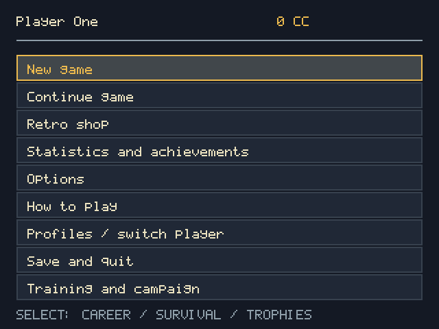
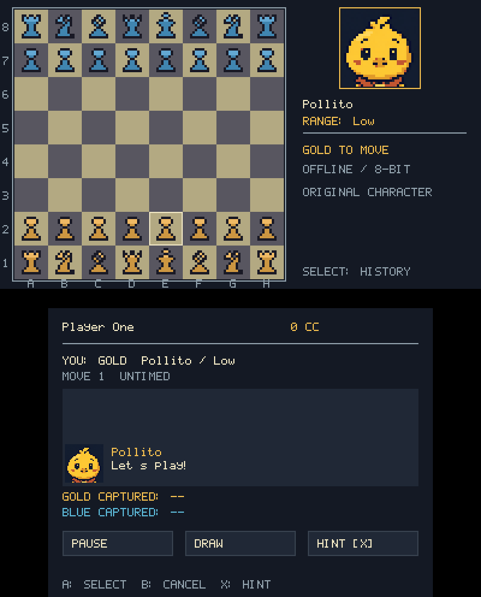
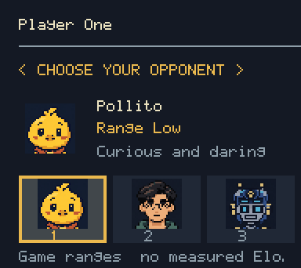
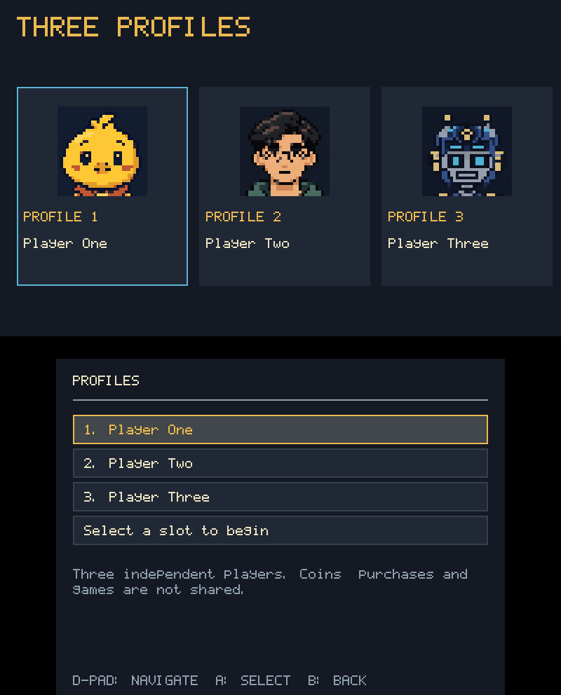
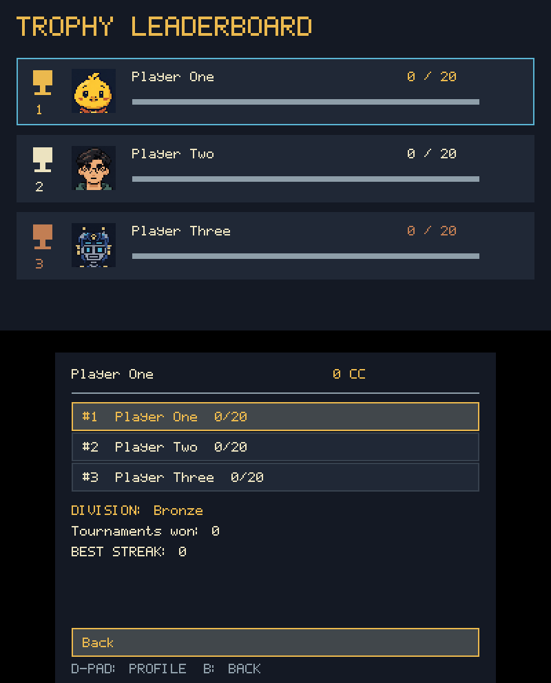
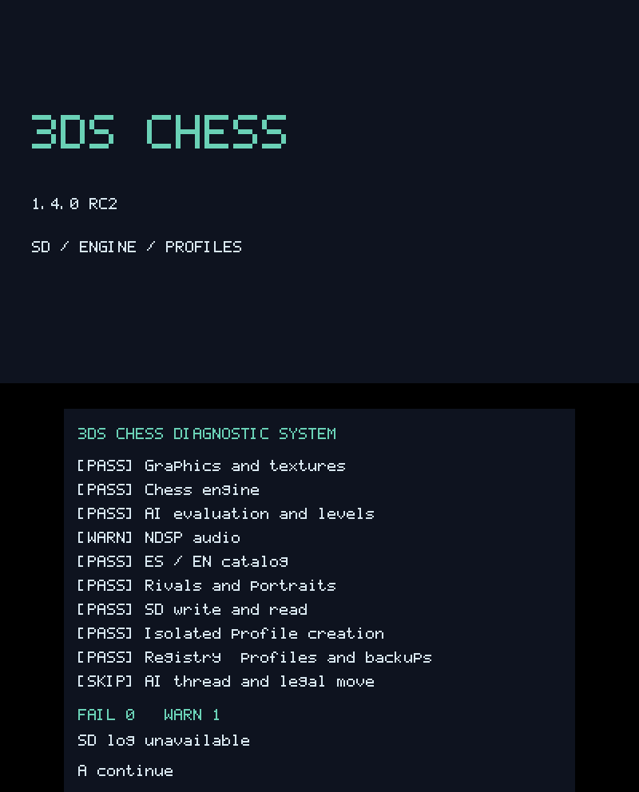
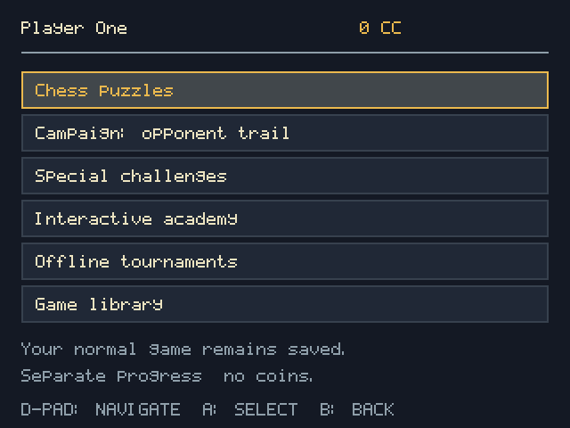
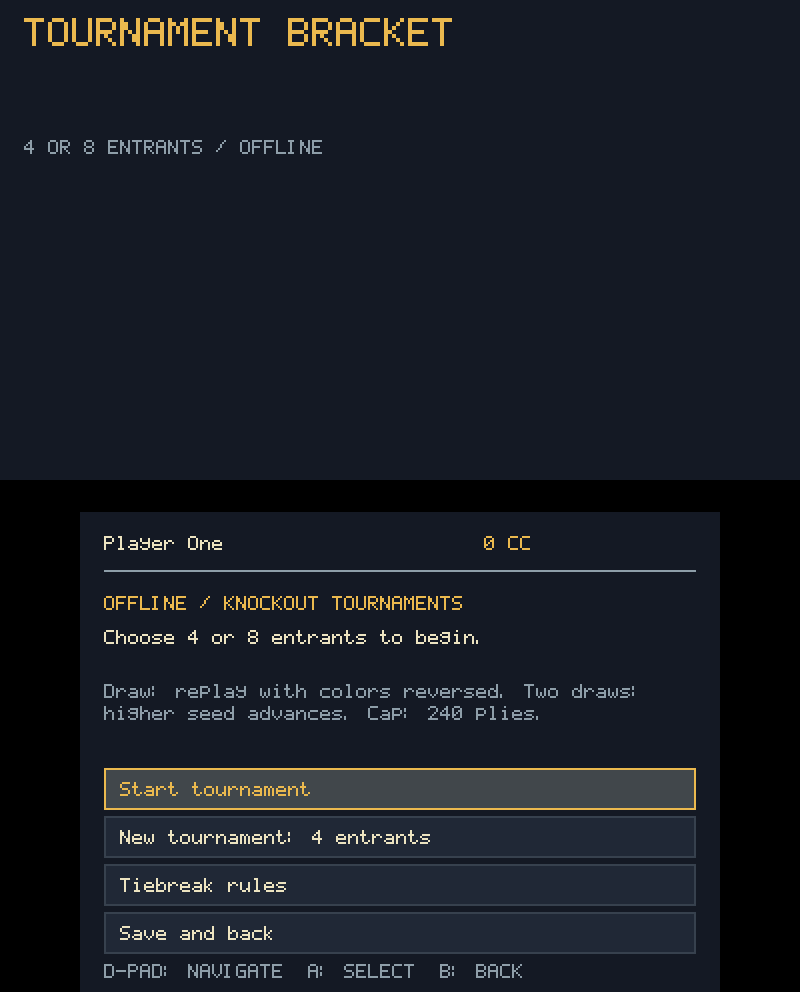

# 3DS Chess gallery · Galería

The screenshots show real game views rendered by the **desktop test renderer**
from the [1.4.0 RC2 candidate](https://github.com/Perrodevs/3ds-chess/tree/fix/stability-quality-update).
They are software-rendered captures, not photos of hardware or Azahar captures.
The fixture used a temporary SD data directory and synthetic profile names.

Las capturas provienen del renderizador de pruebas del juego en **1.4.0 RC2**.
Los nombres de perfil son ficticios. En menú y entrenamiento se muestra la
pantalla inferior. El selector se recortó a los tres rivales con arte original.
El tablero, los retratos originales de Pollito, Hamchow y Byte, y la interfaz
proceden del juego. El atlas mixto se mantiene fuera de este repositorio.

| Main menu · Menú principal | Match · Partida |
| --- | --- |
|  |  |

| Rivals · Rivales | Profiles · Perfiles |
| --- | --- |
|  |  |

| Trophy leaderboard · Tabla de trofeos | Diagnostics · Diagnósticos |
| --- | --- |
|  |  |

| Training · Entrenamiento | Tournament · Torneo |
| --- | --- |
|  |  |

## Repository art · Arte del repositorio

[Banner](banner.webp) and [social preview](social-preview.png) use the same
original cover generated with the integrated image tool and resized to 1280 × 640.
The prompt specified dark navy 16-bit pixel art, purple lines, gold and blue chess pieces, a generic unbranded
dual-screen handheld, “3DS CHESS” and “A Dual-Screen Chess Adventure”.
The handheld illustration is cover art. The gallery above depicts the actual UI.

[English README](../../README.md) · [README en español](../README_ES.md) ·
[Asset rights](../ASSET_RIGHTS.md)
